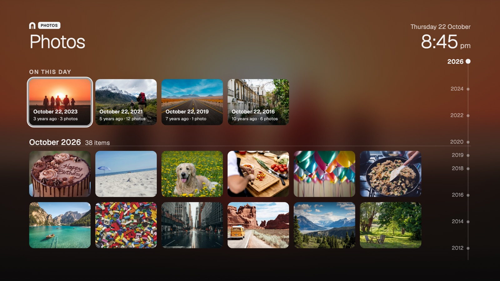
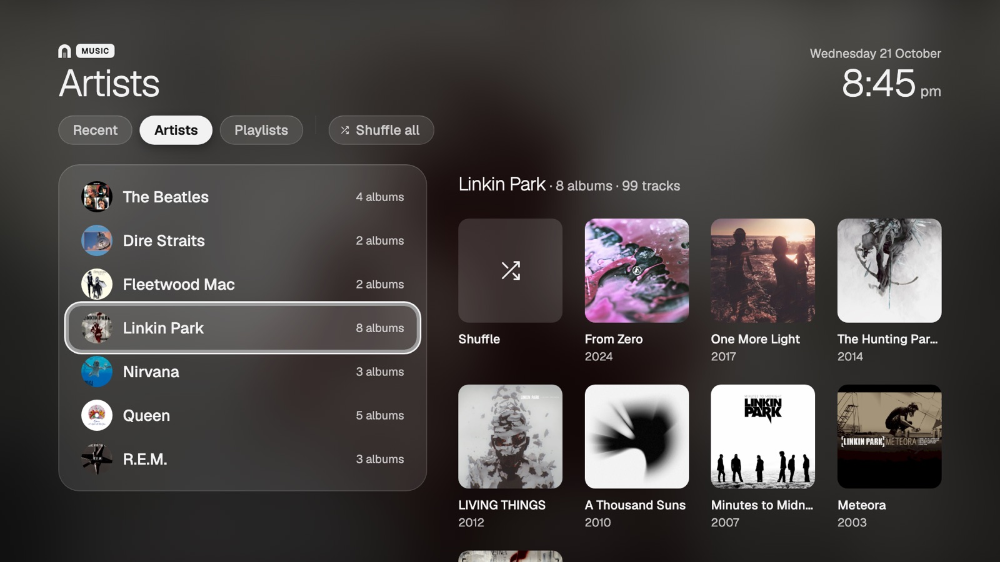
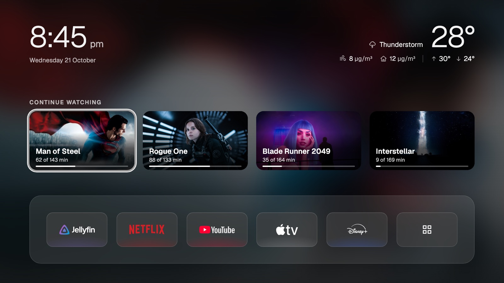
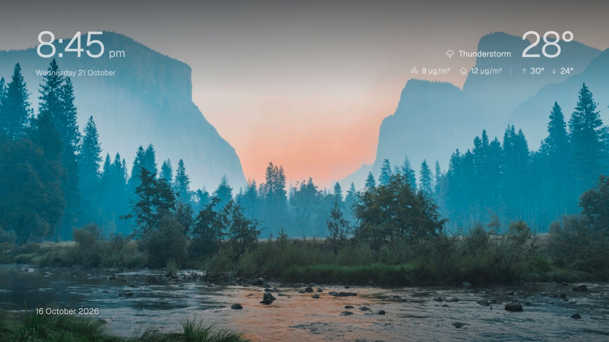

<div align="center">

# arca TV

**Your photos. Your music. Your TV.**

A calm home screen for Google TV and Android TV.<br>
Connect [arca](https://arca.satoshi-ltd.com) to bring your photos, videos and music to the big screen.



[Install](#install) · [Connect your library](#connect-your-arca-library) · [Discover arca](https://arca.satoshi-ltd.com)

</div>

## Your library, in the living room

arca TV gives you a quiet place to turn the TV on: your apps, the time and optional weather, without ads or recommendation rows added by arca TV. It works without an arca hub.

Connect a hub and it becomes a way to enjoy your own library from the sofa:

- **Photos and memories.** Browse photos and videos in one timeline, revisit *On this day* in earlier years, or open a photo and let the slideshow run. OK pauses it.
- **Your albums.** Recent plays, artists, albums and playlists, with shuffle for an artist or the whole library.
- **A screen worth leaving on.** A gently moving photo screensaver that draws from across your library and dims at night.

[arca](https://arca.satoshi-ltd.com) is a personal drive you run yourself. A computer or server you control keeps your shared folders and their history; your phones and other computers synchronize complete copies. arca TV plays from that hub over your network without changing the library. [Set up arca →](https://arca.satoshi-ltd.com/#setup)

## What you need

| Experience | Needs |
| --- | --- |
| Home screen, app shortcuts, quick settings, colour screensaver | Google TV or Android TV, Android 9 or newer |
| Weather and outdoor air | An internet connection and a selected city; optional |
| Photos, videos, music and photo screensaver | A reachable arca hub with the corresponding libraries enabled |
| Continue watching | Your Jellyfin server; optional |
| Indoor air and device controls | Your domo server and supported devices; optional |

Installation uses a computer on the same network. No root is needed. arca TV changes the home screen and screensaver and disables selected built-in apps; nothing is uninstalled. **Home screen → Original** restores the recorded home screen and re-enables the apps it disabled. A watchdog attempts recovery after repeated crashes.

## A look around

| | |
| --- | --- |
|  |  |
| **Photos.** Your pictures fill the screen; videos play inline. | **Music.** Pick an artist, an album or shuffle. |
|  |  |
| **Home.** Your apps, optional Jellyfin, weather and indoor air. | **Screensaver.** Photos from across the years. |

Screens show sample content. More views are in [`docs/screens/`](docs/screens/).

## Install

You need a Google TV or Android TV (Android 9 or newer) and a computer on the same network. Installation needs access to the TV’s debugging options; menu names and manufacturer restrictions vary. LG webOS and Samsung Tizen are not supported. Let an assistant with terminal access help, or build and install manually.

### With an AI assistant (recommended)

1. **On the TV:** Settings → System → About → press *Android TV OS build* seven times. Back in System, open **Developer options** and turn on **USB debugging**. Write down the TV's IP address (Settings → Network & Internet).
2. **On your computer:** open an AI coding assistant and say:
   ```
   Install arca TV (github.com/satoshi-ltd/arca-tv) on my TV at <TV_IP>. I live in Tokyo.
   ```
   Use your TV’s IP in place of `<TV_IP>` and your own city in place of Tokyo. The assistant needs terminal access. To add *Continue watching* or arca domo, say so in the same request, for example: `My Jellyfin is at http://<JELLYFIN_IP>:8096` or `My domo server is at http://<DOMO_IP>:8800`; the assistant leaves the tokens empty in `config.yaml` for you to paste them in yourself, so they never go through the chat.
   It downloads the code, builds the app and puts it on your TV, asking before installing any missing tools on your computer. When the TV asks *Allow USB debugging?*, tick *Always allow* and accept.
3. **Back on the TV:** open **arca TV → Home screen → arca TV** and accept the debugging prompt (tick *Always allow*). The first time, a short welcome walks you through connecting your arca hub. To go back to the factory home screen: **arca TV → Home screen → Original**.

### Manual

Replace `<TV_IP>` with your TV’s IP address in the commands below. Run the build and install commands from the project folder.

1. **On the TV:** turn on Developer options and USB debugging (as above) and note its IP address.
2. **Tools:** a JDK (17 or newer), the Android SDK command-line tools and `adb`. On a Mac:
   ```bash
   brew install --cask temurin android-commandlinetools android-platform-tools
   sdkmanager "build-tools;34.0.0" "platforms;android-34"
   ```
   If Android Studio is installed you can skip Temurin and use its JDK: `export JAVA_HOME="/Applications/Android Studio.app/Contents/jbr/Contents/Home"`.
3. **Build:**
   ```bash
   git clone https://github.com/satoshi-ltd/arca-tv && cd arca-tv && ./build.sh
   ```
   The first run creates `config.yaml` (and the signing key `arca-tv.keystore`) and builds an APK with empty settings. Optionally add your city and service settings (below), then run `./build.sh` again. The result is `ArcaTV.apk`.
4. **Install:**
   ```bash
   adb connect <TV_IP>:5555
   adb devices
   adb -s <TV_IP>:5555 install -r ArcaTV.apk
   ```
   The first `adb connect` makes the TV ask *Allow USB debugging?*: tick *Always allow* and accept, wait until `adb devices` shows `<TV_IP>:5555` as `device`, then install. If it says `unauthorized`, reconnect and accept the prompt; if it is offline, check the network and debugging setting. On TCL TVs, also let it run in the background (TCL blocks it by default):
   ```bash
   adb -s <TV_IP>:5555 shell "appops set com.satoshilimited.tv AUTO_START allow || appops set com.satoshilimited.tv APP_AUTO_START allow"
   ```
5. **On the TV:** open **arca TV → Home screen → arca TV** and accept the debugging prompt (tick *Always allow*). To go back: **Home screen → Original**.

Keep `arca-tv.keystore`: every update must be signed with the same key, or Android refuses to install it over the old one.

### Configuration

`config.yaml` stays on your machine and is never committed. Every value is optional. You can choose the weather city during welcome or later in Settings → Weather:

```yaml
city: "Tokyo"

jellyfin:              # the Continue watching row
  url: "http://<JELLYFIN_IP>:8096"
  token: ""            # create it in your Jellyfin dashboard

domo:                  # arca domo: your domo server
  url: "http://<DOMO_IP>:8800"
  token: ""
```

Paste tokens into `config.yaml` yourself. Never share them or commit them. An older `config.properties` is moved into `config.yaml` by the next build.

## Connect your arca library

No hub yet? Start with [arca](https://arca.satoshi-ltd.com/#setup). A computer you already own can be the hub, or you can run one with Docker. Phones connect to a hub; they cannot act as one.

1. **Prepare the library on your hub.** Link a phone album to a hub folder, or choose **Enable gallery** in an existing folder’s ⋯ menu. For music, choose **Enable music library** in the folder’s ⋯ menu.
2. **Allow the local connection.** Keep the TV and hub on the same network. On the hub, open **Settings → Local network** and enable **Allow HTTP connections**. The TV uses this local connection; use a home network you trust.
3. **Get a device pairing code from the hub** under **Settings → Authorized devices → Manage devices**. On the TV, open **Settings → Hub**. It finds the hub and opens its code screen directly. If none is found, try again or choose **Enter address**.
4. **Enter the six digits on the TV.** The code is single use. Once connected, **arca Photos** and **arca Music** appear for the libraries your hub exposes; add them to the shelf in **Settings → Shortcuts**.

The hub must be on and reachable while the TV streams photos, videos or music. arca TV is a player, not a full synchronized copy of your files. Its credential cannot edit your library. You can disconnect it on the TV or revoke it from the hub.

The TV is named **arca TV** by default. Change it in **Settings → TV name**; the hub receives the new name.

## Using the remote

| Where | Keys |
| --- | --- |
| Everywhere | D-pad moves, **OK** opens, **Back** goes up one level |
| Home | **Down** goes to the shelf, **OK** on *All apps* opens the grid; with arca domo, **Up** from *Continue watching* (or from the shelf when that row is empty) focuses the weather corner and **OK** opens *Domo* |
| arca domo | D-pad moves between rooms, **OK** opens one; in a room **Up/Down** moves between Power, Mode and Fan (or Start, Stop and Dock), **Left/Right** between choices, **OK** applies, **Back** returns to the rooms |
| Photos explorer | **Up/Down** scrolls (hold to accelerate: 1 row, then 2, then 4, then a month at a time), **Left/Right** moves, hold **Left/Right** or press fast-forward/rewind to jump a month, **OK** opens a photo, **Play/Pause** starts the slideshow |
| Photo viewer | **Left/Right** previous and next, the slideshow runs on its own from the photo you opened, **OK** pauses and resumes it (or a video), **Back** returns to the explorer |
| Music | **Left/Right** switches tab from the tab row, **Down** enters, in *Artists* **Right** moves into the albums, **Right** past *Playlists* reaches *Shuffle all*, the first tile of an artist's albums is that artist's *Shuffle*, **OK** plays, **Back** goes up one level |
| Now playing | **Left/Right** moves between previous, play/pause and next, **OK** presses; media keys work |
| Screensaver | Any key exits |

### arca Photos

- **On this day**: when earlier years have photos from today's date, Photos opens on a row of up to four of those days; moving along it changes the background to each one, and **OK** takes you to that photo.
- Opens on the newest month, named once in the title. The scrubber on the right lists the years; while you hold Up or Down to scroll fast, a chip next to it names the month and how many photos it has.
- Thumbnails come from the hub and are cached in memory and on disk, so returning to cached months is quick. The large size is loaded only when you open a photo.
- Videos show as thumbnails with a play badge and play inline when opened, with their own progress bar; **OK** pauses and resumes, **Left/Right** stop it and move to the neighbour.
- The slideshow, the viewer and the screensaver move photos the same way: each one fills the screen and, over its display time, including the fades, comes 4 % closer while it glides slowly along the side that has room (up or down for most photos, from the top third toward the middle for portraits, sideways for panoramas). Opening a photo from the explorer starts the slideshow from it; **OK** pauses. Each photo shows its date. There are no on-screen navigation arrows.

### arca Music

- **Recent** keeps the last twelve albums played on this TV.
- **Shuffle all** sits at the end of the tab row and plays random tracks from your whole library. In **Artists**, the albums of the highlighted artist are shown on the right without entering; their first tile is **Shuffle**, that artist's tracks shuffled. **OK** on an album opens it.
- **Playlists** are the `.m3u8` files in your music folder, read only on the TV. A playlist's cover is its first track's cover.
- The player fills the screen with the cover, blurred behind it. Music plays only inside arca Music and stops when you leave.

### arca domo

The home automation part of arca, read from your own domo server. Today it shows the air in every room and controls your air purifiers and robot vacuum.

- Appears when `domo.url` is set in `config.yaml`; set `domo.token` too so it can connect to your server. Without a URL, nothing about domo appears on the TV. There is no setup screen for it.
- *Devices* lists every purifier, then the vacuum. PM2.5 is the largest number; the level (Excellent, Good, Light, Moderate, Heavy, Severe) is a word plus a six-step bar. Humidity and temperature appear only where the purifier reports them, and a *Filter* badge appears at 10 % or less.
- A reading's age shows only when it is old: in amber after 2 minutes, dimmed and *Out of date* after 5. A room that stops answering keeps its last values dimmed with *No response*.
- Purifiers: Power, Mode (Auto, Sleep, Favorite) and Fan 0 to 14, which only works in Favorite. Vacuum: Start, Stop and Dock. Each press waits for the home server and then shows the state it returns; if the device doesn't answer, the control goes back and a short line says so.
- The background follows the worst room: arca green while the air is Excellent or Good, amber at Light or Moderate, red at Heavy or Severe. Readings refresh every 10 seconds while *Domo* or Home is on screen.

### Screensaver

Starts after one minute without input, on any arca screen. With a hub it shows your photos, each one picked at random from anywhere in your whole library, so years and places mix, with a soft crossfade; without one it shows a slow colour wash. At night, from 10 pm to 6 am, it dims itself. Turn it off in **Settings → Screensaver**.

## Privacy and local playback

arca TV adds no accounts, ads, analytics or telemetry. Photos and music stream from your hub; Jellyfin and domo connect directly to the servers you configure. The hub receives the TV’s name, app version and the library folder IDs it uses. The TV’s player credential cannot edit library files and can be revoked from the hub.

Weather is optional: city searches send the name you enter to Open-Meteo, and forecast and outdoor-air requests send that city’s coordinates. Those requests also expose your public IP to the service. Android TV and the apps you open have their own network activity and privacy policies; arca TV does not make them local-only.

The hub credential stays in the app’s private storage. Jellyfin and domo keys are compiled into your APK from `config.yaml`; keep that APK private. Never share or commit `config.yaml`, tokens or the signing key.

## Development

Plain Java at Java 8 language level: minSdk 28, targetSdk 33. The only library is AndroidX Media3 (ExoPlayer) for video, pinned by SHA-256 in `libs.txt` and downloaded on the first build, so that build needs internet. `build.sh` builds with aapt2, javac, R8 and apksigner, without Gradle. Screens are drawn on Canvas with shared glass, backdrop, icon and header components. The current APK is about 1.4 MB.

Build with `./build.sh`; success ends with `Built ArcaTV.apk`. There is no Java test harness; functional changes are checked on a real TV. See [AGENTS.md](AGENTS.md) for implementation and device-testing rules.

## Project layout

```
app/                    Android app: sources, resources, assets
  src/com/satoshilimited/tv/   Home, panel, settings, hub client, photos, music, screensaver
thumbnails/             App logos on glass tiles: JSON, SVG sources, tools and tests
docs/screens/           Product screenshots with sample content
site/                   The website: one static page, its build script and tests
build.sh                aapt2, javac, R8 and apksigner; no Gradle
libs.txt                Pinned libraries (Media3 and its dependencies)
config.example.yaml
```

Key files: `HomeView` (home and panel), `SettingsActivity`, `HubActivity` (pairing), `ArcaHub` (hub client), `PhotoLibrary` and `PhotosExplorerActivity`, `HubPhotosActivity` and `PhotoSlideshow`, `HubMusicActivity` and `MusicLibrary`, `DomoActivity` and `ArcaDomo` (arca domo), `Backdrop` (backgrounds), `Glass` (container style), `IdleSaver` and `DreamView` (screensaver).

### App thumbnails

`thumbnails/` holds the tile for each known app. To add one, edit `thumbnails/thumbnails.json`, drop an SVG in `thumbnails/logos/`, run `python3 thumbnails/tools/validate.py`, then `python3 thumbnails/tools/render.py` (needs `rsvg-convert`). Tests: `python3 -m pytest thumbnails/tests`. See `thumbnails/README.md`.

### Website

`site/` is one static page in the app’s own look: HTML, CSS, Geist and a small script for the install tabs and the Copy button. The hero shows a CSS-only Home demo with a pause button and reduced-motion support, followed by the standalone home screen, what an arca hub adds, photos and music. There is no framework, tracking, cookies or third-party request, and the content security policy allows only the site's own files.

```bash
npm --prefix site test
npm --prefix site run build
python3 -m http.server --directory site/dist 4179
```

The build copies the screenshots from `docs/screens/` and the font from `app/assets/fonts/` into `site/dist`, and fails if the page names a file that is not there. `.github/workflows/publish-site.yml` tests, builds and uploads it to Cloudflare Pages with Wrangler, the same direct-upload pipeline as arca. It needs the secrets `CLOUDFLARE_ACCOUNT_ID` and `CLOUDFLARE_API_TOKEN` and the variables `CLOUDFLARE_PAGES_PROJECT_NAME` and `SITE_URL`.

## Credits and license

Free for personal and non-commercial use under the [PolyForm Strict License 1.0.0](LICENSE), the same license as arca. Copyright Satoshi Ltd. App logos are trademarks of their owners and are shown only to identify their apps.
